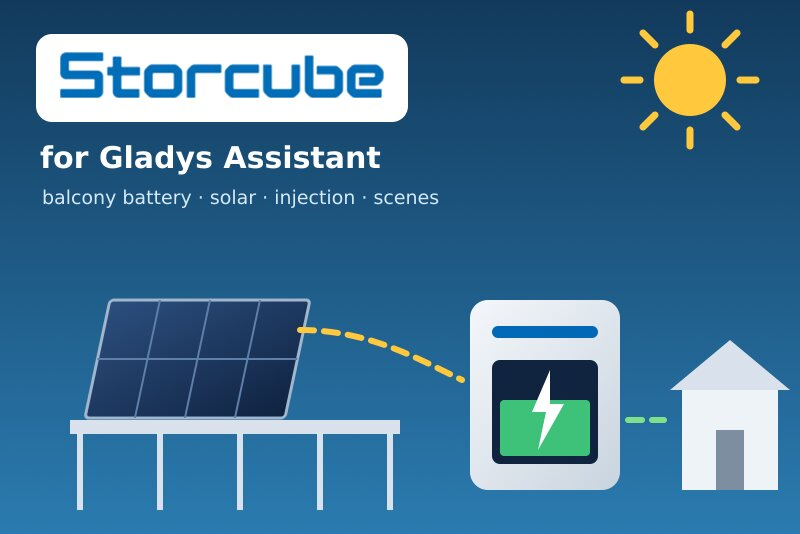
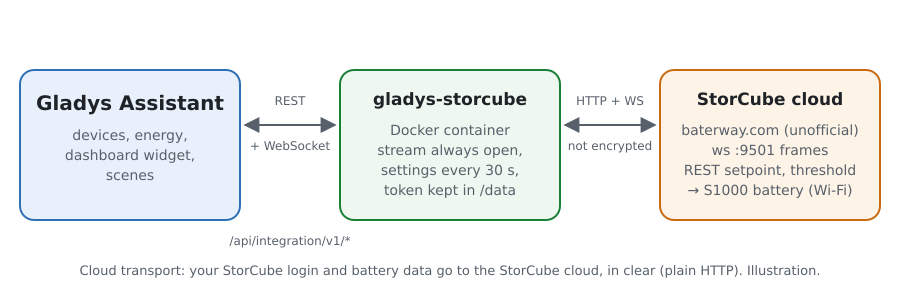
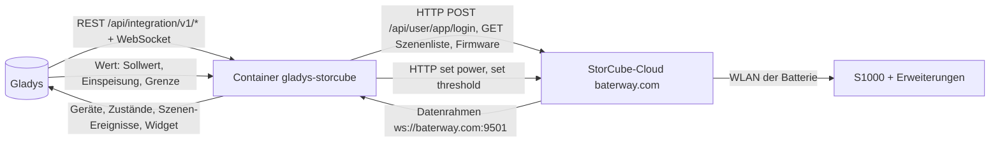
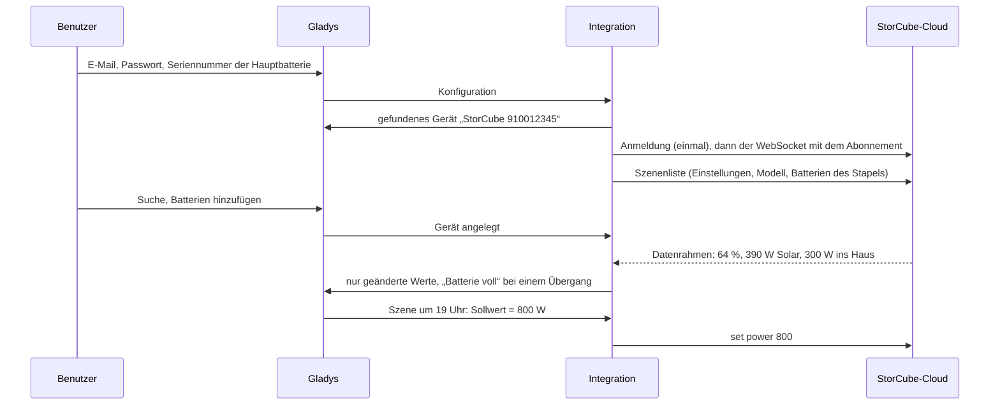
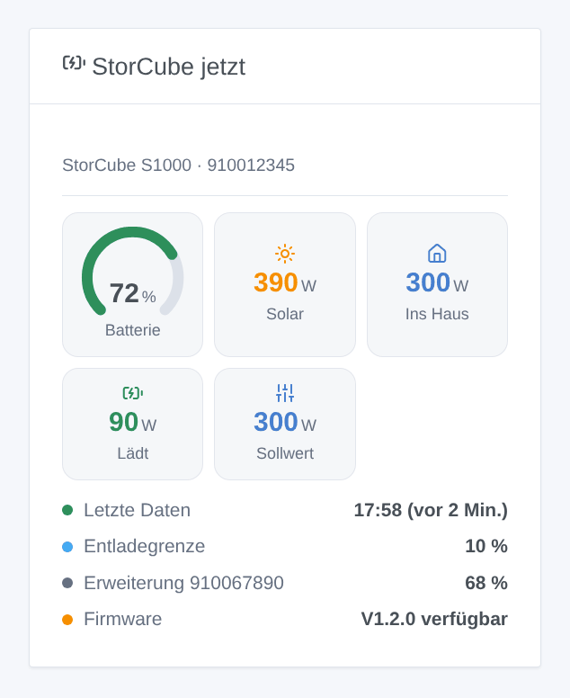

# Gladys StorCube

[English](README.md) · [Français](README.fr.md) · **Deutsch** · [Español](README.es.md)

[](LICENSE)
[](https://github.com/William-De71/gladys-storcube/releases)
[](https://github.com/William-De71/gladys-storcube/actions/workflows/release.yml)
[](https://gladysassistant.com)



Externe Integration für [Gladys Assistant](https://gladysassistant.com) für **StorCube**-Balkonbatterien (S1000 und ihre Erweiterungsbatterien), über die StorCube-Cloud und das Konto der StorCube-App. Sie zeigt in Gladys den Batteriestand, die Solarleistung und die ins Haus eingespeiste Leistung und lässt deine Szenen die Einspeisung ein- oder ausschalten, den Ausgangssollwert und die Entladegrenze ändern — zum Beispiel, um die Energie am Abend abzugeben.

Benutzerdokumentation: [English](docs/en.md) · [Français](docs/fr.md) · [Deutsch](docs/de.md) · [Español](docs/es.md).

Nicht mit StorCube verbunden. **Die API der StorCube-Cloud ist weder dokumentiert noch offiziell**: Anfragen und Datenrahmen folgen der Home-Assistant-Integration [storcube_Ha](https://github.com/jon7119/storcube_Ha) (MIT), die echte S1000-Batterien liest. **Noch nicht mit einer echten Batterie getestet**; nur die Antwort auf ein unbekanntes Konto wurde echt geprüft. Rückmeldungen gern im [Forenthread](https://community.gladysassistant.com/t/demande-integration-batterie-storcube-s1000/11472).

## Funktionen

- **Ein Gerät pro Batterie** des Stapels: Stand, gespeicherte Energie, Temperatur.
- An der **Hauptbatterie** (an der Module und Mikro-Wechselrichter hängen): Solarleistung (PV1 + PV2), ins Haus eingespeiste Leistung, Lade- und Entladeleistung und drei Befehle — **Ausgangssollwert** (0 bis 800 W), **Einspeisung ein / aus** (aus = 0 W, ein = der letzte Sollwert), **Entladegrenze** (0 bis 100 %).
- **Echtzeit**: der WebSocket-Datenstrom der StorCube-Cloud, dazu die Einstellungen des Stapels alle 30 Sekunden.
- **6 Szenen-Auslöser** (Batterie voll, Batterie an der Grenze, Batterie stumm, Batterie zurück, Firmware-Update, Anmeldung abgelehnt) und **1 Dashboard-Widget** (der Stapel jetzt).
- **Eine einzige Anmeldung**, ihr Token 12 Stunden gehalten (die Cloud verträgt mehrere Sitzungen eines Kontos schlecht); eine abgelehnte Anmeldung stoppt alles, bis du die Konfiguration änderst, damit das Konto nie gesperrt wird.
- Vier Sprachen überall: Englisch, Französisch, Deutsch, Spanisch.

## Funktionsweise





Vom Konto zur Szene:



### Transport

`transports: ["cloud"]`: Alles läuft über die StorCube-Cloud (`baterway.com`), den Server der StorCube-App. **Deine E-Mail, dein Passwort und die Daten deiner Batterien verlassen dein Netz unverschlüsselt** (reines HTTP und WebSocket, genau wie die App): Nutze ein Passwort, das du nirgends sonst verwendest. `/data` speichert das Token der Cloud, die letzten Messwerte, die Einstellungen des Stapels und was die Auslöser wissen — nie das Passwort.

## Geräte und Funktionen

| Gerät                     | Funktionen (Kategorie / Typ)                                                                                                                                                                                                                                                                                                                                                                                                                                                                                                                                                                 |
| ------------------------- | -------------------------------------------------------------------------------------------------------------------------------------------------------------------------------------------------------------------------------------------------------------------------------------------------------------------------------------------------------------------------------------------------------------------------------------------------------------------------------------------------------------------------------------------------------------------------------------------- |
| Hauptbatterie             | Batteriestand (`battery-storage` / `battery-level`, %), gespeicherte Energie (`battery-storage` / `battery-energy-remaining`, kWh), Lade- und Entladeleistung (`battery-storage` / `charge-power`, `discharge-power`, W), Solarleistung (`energy-production-sensor` / `power`, W), ins Haus eingespeiste Leistung (`home-output-sensor` / `power`, W), Ausgangssollwert (`switch` / `dimmer`, 0–800 W, schreibbar), Einspeisung ins Haus (`switch` / `binary`, schreibbar), Entladegrenze (`switch` / `dimmer`, 0–100, schreibbar), Temperatur (`device-temperature-sensor` / `decimal`, °C) |
| Jede Erweiterungsbatterie | Batteriestand, gespeicherte Energie, Temperatur                                                                                                                                                                                                                                                                                                                                                                                                                                                                                                                                              |

- **Batterieleistung**: Die API liefert keine; wie storcube_Ha berechnet die Integration sie (Solar minus eingespeiste Leistung), aufgeteilt in Lade- und Entladeleistung (beide positiv), wie es die Kategorie Batteriespeicher von Gladys verlangt.
- **Sollwert und Grenze** sind Funktionen `switch` / `dimmer`: Kein Gladys-Typ ist ein Leistungssollwert, und der Dimmer ist der schreibbare Wert, den das Dashboard als Schieberegler zeigt und Szenen setzen können. Die Grenze hat keine Einheit (`%` ist keine Einheit der Kategorie Schalter); ihr Name sagt es.
- **Kein Energiezähler**: Die Datenrahmen kommen unregelmäßig, manchmal Minuten auseinander; ein daraus integrierter Zähler wäre geschätzt. Gladys speichert den Verlauf der Leistungen.
- Die externen IDs beruhen auf den Seriennummern: `ext:storcube:battery:<Seriennummer>`.

## Szenen-Auslöser und Widgets



**Widget** StorCube jetzt: Batterieanzeige (rot an der Grenze), Solar, Leistung ins Haus, Laden oder Entladen, Sollwert (oder „Einspeisung aus“), die Zeit der letzten Daten (oder „stumm seit“), die Entladegrenze, der Stand jeder Erweiterungsbatterie und eine wartende Firmware.

**Auslöser** (ein Ereignis pro Übergang, nie beim ersten Messwert, nie als Folge eines Befehls):

- **Batterie voll** bei 100 % (erneut, nachdem sie unter 95 % fiel);
- **Batterie an der Grenze**: Der Stand erreicht die Entladegrenze, die Batterie speist nicht mehr ein (erneut 5 Punkte darüber);
- **Batterie stumm**: seit 20 Minuten kein Datenrahmen, obwohl die Cloud antwortet; **Batterie zurück**, wenn wieder Datenrahmen kommen;
- **Firmware-Update**: Die Cloud bietet eine neue Firmware an (einmal pro Version);
- **Anmeldung abgelehnt**: Die Cloud lehnt E-Mail oder Passwort ab (einmal).

Filter: die Batterie. Die Werte (Stand, Leistungen) sind Gerätefunktionen: „Batterie über 80 %“ ist ein Geräte-Auslöser von Gladys.

Keine Szenen-Aktion: Die Befehle sind Gerätefunktionen, gesetzt mit der Aktion **Ein Gerät steuern** der Szenen.

Beispiele:

- Jeden Tag um 19 Uhr → **Ausgangssollwert** auf 800 W setzen; um 23 Uhr → **Einspeisung ins Haus** ausschalten: Die Batterie gibt ihre Energie am Abend ab.
- Wenn **StorCube: Batterie voll** → den Sollwert auf 300 W setzen, damit das Haus die Sonne direkt nutzt.
- Wenn **StorCube: Batterie stumm** → eine Benachrichtigung senden „{{triggerEvent.data.battery_name}} sendet nichts mehr an die StorCube-Cloud“.

## Voraussetzungen

- Gladys Assistant **5.3.0** oder neuer (Katalog-Stichwörter, Widgets und Szenen von Integrationen): ältere Instanzen können die Integration nicht installieren.
- Eine in der StorCube-App eingerichtete StorCube-Batterie, deren E-Mail und Passwort, und die Seriennummer der Hauptbatterie (auf dem Etikett oder in der App).
- Internet: Die Integration spricht nur mit `baterway.com`.

### Grenzen der StorCube-Cloud

- Inoffizielle API: StorCube kann sie jederzeit ändern und die Integration brechen.
- Reines HTTP: Das Passwort geht im Klartext, wie bei der App.
- Ein Konto, mehrere Sitzungen: App und Gladys können sich stören; die Integration meldet sich einmal an und behält ihr Token.
- Datenrahmen brauchen manchmal Minuten; die Erweiterungsbatterien melden nur Stand, Energie und Temperatur.
- Der Feldname der Grenze ändert sich mit der Firmware: Die Integration probiert `reserved`, `threshold`, `data` und behält das akzeptierte.

## Installation

- **Aus dem Store**: Integrationen → StorCube → Installieren.
- **Über die URL des Repositorys**: Integrationen → externe Integration → `https://github.com/William-De71/gladys-storcube`.
- **Entwicklermodus**: `npm start` mit den Variablen starten, die Gladys vorgibt (siehe Entwicklung).

## Konfiguration

| Feld oder Schaltfläche         | Standard    | Bedeutung                                                                           |
| ------------------------------ | ----------- | ----------------------------------------------------------------------------------- |
| E-Mail der StorCube-App        | —           | Pflichtfeld                                                                         |
| Passwort                       | —           | Pflichtfeld, geheim: nie wieder angezeigt, nie protokolliert, nie in `/data`        |
| Seriennummer der Hauptbatterie | —           | Pflichtfeld: die Batterie, an der Module und Mikro-Wechselrichter hängen            |
| App-Code                       | Storcube    | Stehen lassen, außer deine Batterie nutzt eine andere App derselben Cloud           |
| Sprache der Texte              | automatisch | Namen der Funktionen und Fehler                                                     |
| Verbindung testen / Diagnose   | —           | Meldet sich an und liest die Einstellungen; der Zustand im Protokoll, ohne Passwort |

## Nutzung

1. In Gladys (Integrationen → StorCube → Konfiguration): E-Mail, Passwort und Seriennummer eintragen; **Verbindung testen** drücken.
2. **Suchen**, dann deine Batterien als Geräte hinzufügen.
3. Das Widget zu einem Dashboard hinzufügen; Szenen mit den Funktionen und Auslösern bauen (zum Beispiel die abendliche Einspeisung oben).

## Entwicklung

```bash
npm install
npm test                       # node --test, eine falsche StorCube-Cloud auf 127.0.0.1, nie das Netz
npm run lint                   # ESLint
npm run format:check           # Prettier
npx github:GladysAssistant/integration-store . --skip-image-check
scripts/build-cover.sh         # cover.jpg aus docs/assets/cover.svg (Logo eingebettet)
docs/illustrations/render.sh   # docs/assets/widgets.<Sprache>.png
```

Lokal liest das SDK `GLADYS_HOST_API_URL`, `GLADYS_INTEGRATION_TOKEN` und `GLADYS_INTEGRATION_SELECTOR` (von Gladys im Entwicklermodus vorgegeben), die Integration liest `TZ`. `DEBUG=gladys-integration-sdk` zeigt die Protokolle des SDK.

Die Tests decken den REST-Client ab (Anmeldung, abgelehnte Anmeldung, abgelaufenes Token, Ausweichen beim Feld der Grenze), den WebSocket-Datenstrom (Token im Pfad und im Header, Abonnement, Stille, Wiederverbindung), den Parser (die drei Formen der Datenrahmen, Summen nur zur Hauptbatterie), die Auslöser, die Geräte (die Felder, die der Suchbildschirm verlangt, die Kategorie-Verträge des Kerns), das Widget (`validateWidgetContent`), das Manifest, die vier Sprachen, das Release-Skript und die ganze Integration gegen den falschen Gladys des SDK und eine falsche StorCube-Cloud. `test/structure.test.js` friert jeden Schlüssel ein, den Benutzer speichern.

## Release-Prozess


Jeder Merge auf `main` startet die CI und berechnet dann die Version aus den [Conventional Commits](https://www.conventionalcommits.org/) seit dem letzten Tag: `feat` → Minor, `fix` / `perf` → Patch, `!` oder `BREAKING CHANGE` → Major (unter 1.0.0 ein Minor); `docs`, `chore`, `ci`, `test`, `style`, `refactor`, `build` allein veröffentlichen nichts. Der Changelog-Abschnitt wird erzeugt, der Tag gepusht, das Multi-Architektur-Image gebaut, dann erhält `main` den Release-Commit, das GitHub Release wird angelegt und ein letzter Job prüft das öffentliche Image, den Store-Validator und das Topic.

- Der Titel des Pull Requests wird zum Squash-Commit und dann zur Zeile im Changelog: Schreibe ihn auf Englisch, für den Benutzer (`pr-title.yml` prüft ihn). `CHANGELOG.md` nie von Hand ändern.
- 1.0.0 ist eine Entscheidung: Actions → Release → Run workflow mit `release-as: 1.0.0`. `dry-run` zeigt Version und Notizen, ohne zu veröffentlichen.
- **Geschützter Branch**: Das Release pusht seinen Commit mit `GITHUB_TOKEN` auf `main`. Das Ruleset `protect-main` (kein Löschen, kein Force-Push) lässt ihn durch; eine strengere Regel (Pull Request Pflicht, Status-Checks) bräuchte GitHub Actions in der Ausnahmeliste oder eine GitHub App.
- Nach dem ersten Release das Paket auf `ghcr.io` öffentlich machen (Package settings → Change visibility), sonst kann Gladys es nicht laden.

## Fehlerbehebung

Siehe [docs/de.md](docs/de.md#fehlerbehebung). Melde Probleme mit den Versionen von Gladys und der Integration, Modell und Firmware der Batterie, der Meldung von **Verbindung testen** und dem Ergebnis von **Diagnose** (im Protokoll der Integration). Füge nie dein Passwort ein.

## Mitwirken

Issues und Pull Requests sind willkommen, vor allem von StorCube-Besitzern: echte Datenrahmen (ohne Seriennummer) helfen sehr. Vor einem Pull Request `npm run format:check && npm run lint && npm test` ausführen und alle externen IDs und gespeicherten Schlüssel unverändert lassen (siehe [CLAUDE.md](CLAUDE.md)).

## Sicherheit

Siehe [SECURITY.md](SECURITY.md): Sicherheitslücken bitte privat melden. Das Passwort ist ein `secret`-Feld: nie protokolliert, nie in `/data` geschrieben; es geht jedoch im Klartext zur StorCube-Cloud, die nichts anderes anbietet.

## Kommende Screenshots

Die Bilder oben sind Illustrationen, keine Screenshots. Echte Screenshots kommen nach `docs/assets/screenshots/` (PNG, 1280 × 800): `configuration.png`, `discovery.png`, `device.png` (die Hauptbatterie mit ihren Funktionen), `scene-evening-injection.png` (die Szene, die den Sollwert um 19 Uhr setzt).

## Lizenz

[Apache-Lizenz 2.0](LICENSE) — siehe auch [NOTICE](NOTICE). StorCube und sein Logo sind Marken ihres Inhabers; dieses Projekt ist nicht mit StorCube verbunden, von StorCube gebilligt oder gesponsert. Danke an die Dokumentation und das SDK von Gladys sowie an jon7119 und xez7082 für storcube_Ha, das die StorCube-Cloud dokumentiert.
