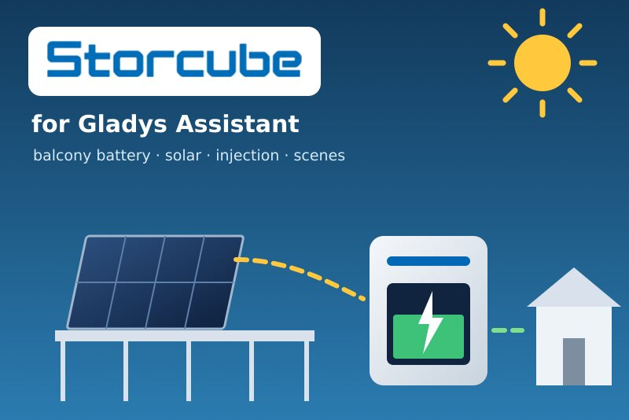
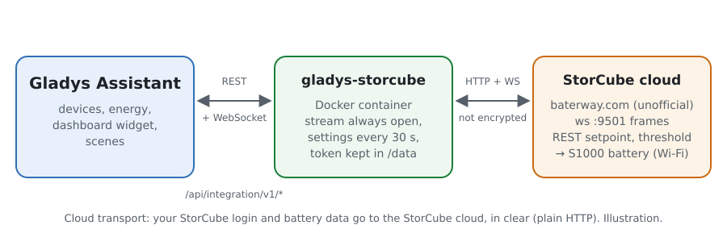
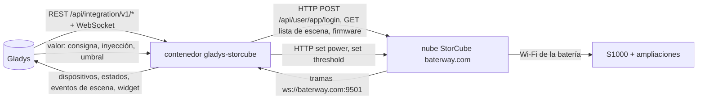
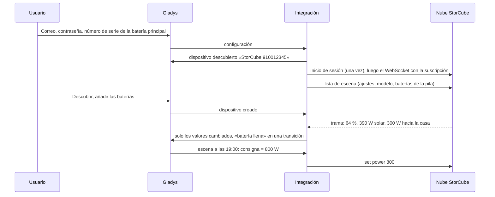
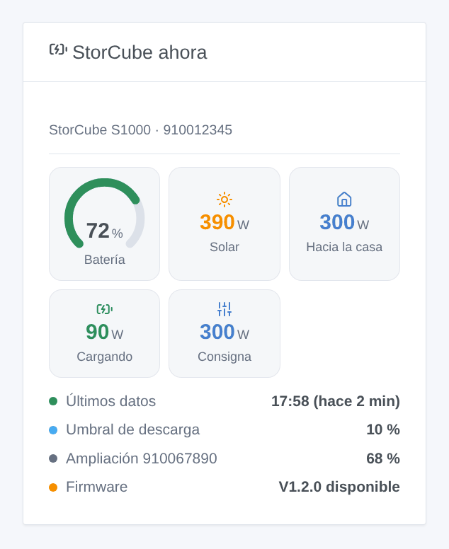

# Gladys StorCube

[English](README.md) · [Français](README.fr.md) · [Deutsch](README.de.md) · **Español**

[](LICENSE)
[](https://github.com/William-De71/gladys-storcube/releases)
[](https://github.com/William-De71/gladys-storcube/actions/workflows/release.yml)
[](https://gladysassistant.com)



Integración externa de [Gladys Assistant](https://gladysassistant.com) para las baterías de balcón **StorCube** (S1000 y sus baterías de ampliación), a través de la nube de StorCube y la cuenta de la aplicación StorCube. Muestra en Gladys el nivel de la batería, la potencia solar y la potencia inyectada en la casa, y permite a sus escenas activar o cortar la inyección, cambiar la consigna de salida y el umbral de descarga — por ejemplo, para devolver la energía por la noche.

Documentación de usuario: [English](docs/en.md) · [Français](docs/fr.md) · [Deutsch](docs/de.md) · [Español](docs/es.md).

No afiliada a StorCube. **La API de la nube de StorCube no está documentada ni es oficial**: las peticiones y tramas siguen la integración de Home Assistant [storcube_Ha](https://github.com/jon7119/storcube_Ha) (MIT), que lee baterías S1000 reales. **Aún no probada con una batería real**; solo se comprobó de verdad la respuesta a una cuenta desconocida. Se agradecen los comentarios en el [hilo del foro](https://community.gladysassistant.com/t/demande-integration-batterie-storcube-s1000/11472).

## Funciones

- **Un dispositivo por batería** de la pila: nivel, energía almacenada, temperatura.
- En la **batería principal** (la conectada a los paneles y al microinversor): potencia solar (PV1 + PV2), potencia inyectada en la casa, potencia de carga y de descarga, y tres órdenes — **consigna de salida** (0 a 800 W), **inyección activada / cortada** (cortada = 0 W, activada = la última consigna), **umbral de descarga** (0 a 100 %).
- **Tiempo real**: el flujo WebSocket de la nube de StorCube, más los ajustes de la pila cada 30 segundos.
- **6 disparadores de escena** (batería llena, batería en el umbral, batería sin datos, batería de vuelta, actualización de firmware, inicio de sesión rechazado) y **1 widget de panel** (la pila ahora).
- **Un solo inicio de sesión**, su token guardado 12 horas (la nube tolera mal varias sesiones de una misma cuenta); un inicio de sesión rechazado lo detiene todo hasta que cambie la configuración, para no bloquear nunca la cuenta.
- Cuatro idiomas en todas partes: inglés, francés, alemán, español.

## Funcionamiento





De la cuenta a una escena:



### Transporte

`transports: ["cloud"]`: todo pasa por la nube de StorCube (`baterway.com`), el servidor que usa la aplicación StorCube. **Su correo, su contraseña y los datos de sus baterías salen de su red sin cifrar** (HTTP y WebSocket simples, igual que la aplicación): use una contraseña que no utilice en ningún otro sitio. `/data` guarda el token de la nube, las últimas lecturas, los ajustes de la pila y lo que saben los disparadores — nunca la contraseña.

## Dispositivos y funciones

| Dispositivo                | Funciones (categoría / tipo)                                                                                                                                                                                                                                                                                                                                                                                                                                                                                                                                                                                  |
| -------------------------- | ------------------------------------------------------------------------------------------------------------------------------------------------------------------------------------------------------------------------------------------------------------------------------------------------------------------------------------------------------------------------------------------------------------------------------------------------------------------------------------------------------------------------------------------------------------------------------------------------------------- |
| Batería principal          | Nivel de batería (`battery-storage` / `battery-level`, %), energía almacenada (`battery-storage` / `battery-energy-remaining`, kWh), potencia de carga y de descarga (`battery-storage` / `charge-power`, `discharge-power`, W), potencia solar (`energy-production-sensor` / `power`, W), potencia inyectada en la casa (`home-output-sensor` / `power`, W), consigna de salida (`switch` / `dimmer`, 0–800 W, modificable), inyección a la casa (`switch` / `binary`, modificable), umbral de descarga (`switch` / `dimmer`, 0–100, modificable), temperatura (`device-temperature-sensor` / `decimal`, °C) |
| Cada batería de ampliación | Nivel de batería, energía almacenada, temperatura                                                                                                                                                                                                                                                                                                                                                                                                                                                                                                                                                             |

- **Potencia de la batería**: la API no la da; como storcube_Ha, la integración la calcula (solar menos potencia inyectada), separada en potencia de carga y de descarga (ambas positivas), como pide la categoría batería de almacenamiento de Gladys.
- **Consigna y umbral** son funciones `switch` / `dimmer`: ningún tipo de Gladys es una consigna de potencia, y el regulador es el nivel modificable que el panel muestra como control deslizante y que las escenas pueden ajustar. El umbral no tiene unidad (`%` no es una unidad de la categoría interruptor); su nombre lo indica.
- **Sin índice de energía**: las tramas llegan de forma irregular, a veces con minutos de diferencia; un índice integrado a partir de ellas sería aproximado. Gladys guarda el historial de las potencias.
- Los identificadores externos se basan en los números de serie: `ext:storcube:battery:<número>`.

## Disparadores de escena y widgets



**Widget** StorCube ahora: indicador de batería (rojo en el umbral), solar, potencia hacia la casa, carga o descarga, consigna (o «inyección cortada»), la hora de los últimos datos (o «sin datos desde»), el umbral de descarga, el nivel de cada batería de ampliación y un firmware pendiente.

**Disparadores** (un evento por transición, nunca en la primera lectura, nunca como resultado de una orden):

- **batería llena** al 100 % (de nuevo tras bajar del 95 %);
- **batería en el umbral**: el nivel llega al umbral de descarga, la batería deja de inyectar (de nuevo 5 puntos por encima);
- **batería sin datos**: ninguna trama en 20 minutos aunque la nube responde; **batería de vuelta** cuando vuelven las tramas;
- **actualización de firmware**: la nube ofrece un nuevo firmware (una vez por versión);
- **inicio de sesión rechazado**: la nube rechaza el correo o la contraseña (una vez).

Filtro: la batería. Los valores (nivel, potencias) son funciones del dispositivo: «batería por encima del 80 %» es un disparador de dispositivo de Gladys.

Sin acción de escena: las órdenes son funciones del dispositivo, ajustadas con la acción **Controlar un dispositivo** de las escenas.

Ejemplos:

- Cada día a las 19:00 → poner **Consigna de salida** a 800 W; a las 23:00 → cortar **Inyección a la casa**: la batería devuelve su energía por la noche.
- Cuando **StorCube: batería llena** → poner la consigna a 300 W para que la casa use directamente el sol.
- Cuando **StorCube: batería sin datos** → enviar una notificación «{{triggerEvent.data.battery_name}} ya no envía nada a la nube de StorCube».

## Requisitos

- Gladys Assistant **5.3.0** o posterior (palabras clave del catálogo, widgets y escenas de integraciones): las instancias más antiguas no pueden instalar la integración.
- Una batería StorCube configurada en la aplicación StorCube, su correo y su contraseña, y el número de serie de la batería principal (en su etiqueta o en la aplicación).
- Internet: la integración solo habla con `baterway.com`.

### Límites de la nube de StorCube

- API no oficial: StorCube puede cambiarla en cualquier momento y romper la integración.
- HTTP simple: la contraseña viaja en claro, como con la aplicación.
- Una cuenta, varias sesiones: la aplicación y Gladys pueden molestarse; la integración inicia sesión una vez y guarda su token.
- Las tramas tardan a veces minutos; las baterías de ampliación solo dan nivel, energía y temperatura.
- El nombre del campo del umbral cambia según el firmware: la integración prueba `reserved`, `threshold`, `data` y guarda el aceptado.

## Instalación

- **Desde la tienda**: Integraciones → StorCube → Instalar.
- **Desde la URL del repositorio**: Integraciones → integración externa → `https://github.com/William-De71/gladys-storcube`.
- **Modo desarrollador**: ejecute `npm start` con las variables que da Gladys (ver Desarrollo).

## Configuración

| Campo o botón                           | Por defecto | Significado                                                                          |
| --------------------------------------- | ----------- | ------------------------------------------------------------------------------------ |
| Correo de la aplicación StorCube        | —           | Obligatorio                                                                          |
| Contraseña                              | —           | Obligatorio, secreto: nunca se vuelve a mostrar, nunca se registra, nunca en `/data` |
| Número de serie de la batería principal | —           | Obligatorio: la batería conectada a los paneles y al microinversor                   |
| Código de aplicación                    | Storcube    | Déjelo, salvo que su batería use otra aplicación de la misma nube                    |
| Idioma de los textos                    | automático  | Nombres de las funciones y errores                                                   |
| Probar la conexión / Diagnóstico        | —           | Inicia sesión y lee los ajustes; el estado en los registros, sin la contraseña       |

## Uso

1. En Gladys (Integraciones → StorCube → Configuración): indique el correo, la contraseña y el número de serie; pulse **Probar la conexión**.
2. **Descubrir**, luego añada sus baterías como dispositivos.
3. Añada el widget a un panel; cree escenas con las funciones y los disparadores (por ejemplo, la inyección nocturna de arriba).

## Desarrollo

```bash
npm install
npm test                       # node --test, una nube StorCube falsa en 127.0.0.1, nunca la red
npm run lint                   # ESLint
npm run format:check           # Prettier
npx github:GladysAssistant/integration-store . --skip-image-check
scripts/build-cover.sh         # cover.jpg desde docs/assets/cover.svg (logo incrustado)
docs/illustrations/render.sh   # docs/assets/widgets.<idioma>.png
```

En local, el SDK lee `GLADYS_HOST_API_URL`, `GLADYS_INTEGRATION_TOKEN` y `GLADYS_INTEGRATION_SELECTOR` (dados por Gladys en modo desarrollador), y la integración lee `TZ`. `DEBUG=gladys-integration-sdk` muestra los registros del SDK.

Las pruebas cubren el cliente REST (inicio de sesión, inicio rechazado, token caducado, alternativa del campo del umbral), el flujo WebSocket (token en la ruta y en la cabecera, suscripción, silencio, reconexión), el análisis (las tres formas de tramas, totales solo para la batería principal), los disparadores, los dispositivos (los campos que exige la pantalla de descubrimiento, los contratos de categoría del núcleo), el widget (`validateWidgetContent`), el manifiesto, los cuatro idiomas, el script de publicación y toda la integración frente al Gladys falso del SDK y una nube StorCube falsa. `test/structure.test.js` fija cada clave que guardan los usuarios.

## Proceso de publicación


Cada fusión en `main` ejecuta la CI y luego calcula la versión a partir de los [Conventional Commits](https://www.conventionalcommits.org/) desde la última etiqueta: `feat` → menor, `fix` / `perf` → parche, `!` o `BREAKING CHANGE` → mayor (una menor por debajo de 1.0.0); `docs`, `chore`, `ci`, `test`, `style`, `refactor`, `build` solos no publican nada. Se genera la sección del changelog, se envía la etiqueta, se construye la imagen multiarquitectura, luego `main` recibe el commit de publicación, se crea la GitHub Release y un último job comprueba la imagen pública, el validador de la tienda y el topic.

- El título de la pull request se convierte en el commit squash y luego en la línea del changelog: escríbalo en inglés, para el usuario (`pr-title.yml` lo comprueba). Nunca edite `CHANGELOG.md` a mano.
- 1.0.0 es una decisión: Actions → Release → Run workflow con `release-as: 1.0.0`. `dry-run` muestra la versión y las notas sin publicar.
- **Rama protegida**: la publicación envía su commit a `main` con `GITHUB_TOKEN`. El ruleset `protect-main` (sin borrado, sin force-push) lo deja pasar; una regla más estricta (pull request obligatoria, status checks) necesitaría GitHub Actions en su lista de excepciones, o una GitHub App.
- Tras la primera publicación, haga público el paquete de `ghcr.io` (Package settings → Change visibility), o Gladys no podrá descargarlo.

## Solución de problemas

Ver [docs/es.md](docs/es.md#solución-de-problemas). Informe de los problemas con las versiones de Gladys y de la integración, el modelo y el firmware de la batería, el mensaje de **Probar la conexión** y el resultado de **Diagnóstico** (en los registros de la integración). No pegue nunca su contraseña.

## Contribuir

Las issues y pull requests son bienvenidas, sobre todo de propietarios de StorCube: tramas reales (sin el número de serie) ayudan mucho. Ejecute `npm run format:check && npm run lint && npm test` antes de abrir una pull request, y mantenga sin cambios todos los identificadores externos y claves guardadas (ver [CLAUDE.md](CLAUDE.md)).

## Seguridad

Ver [SECURITY.md](SECURITY.md): informe de las vulnerabilidades en privado. La contraseña es un campo `secret`: nunca se registra, nunca se escribe en `/data`; sí viaja en claro hacia la nube de StorCube, que no ofrece otra cosa.

## Capturas de pantalla pendientes

Las imágenes de arriba son ilustraciones, no capturas de pantalla. Las capturas reales irán en `docs/assets/screenshots/` (PNG, 1280 × 800): `configuration.png`, `discovery.png`, `device.png` (la batería principal con sus funciones), `scene-evening-injection.png` (la escena que ajusta la consigna a las 19:00).

## Licencia

[Licencia Apache 2.0](LICENSE) — ver también [NOTICE](NOTICE). StorCube y su logotipo son marcas de su propietario; este proyecto no está afiliado, respaldado ni patrocinado por StorCube. Gracias a la documentación y al SDK de Gladys, y a jon7119 y xez7082 por storcube_Ha, que documenta la nube de StorCube.
