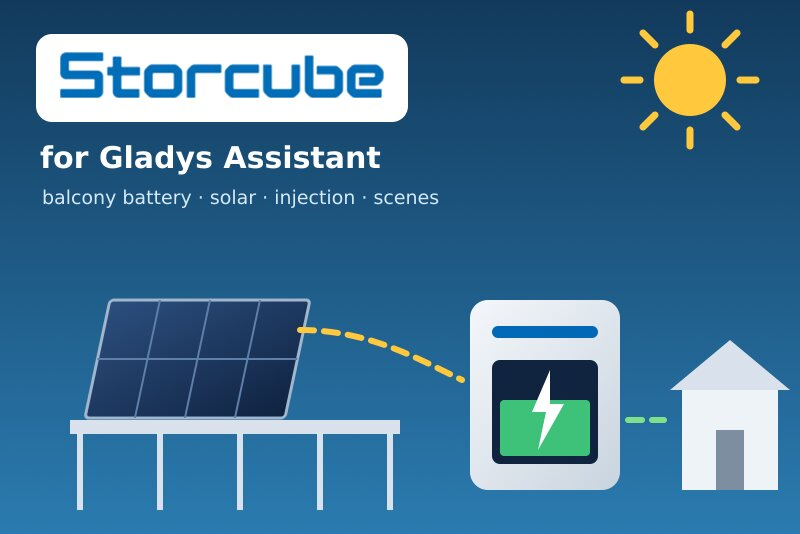
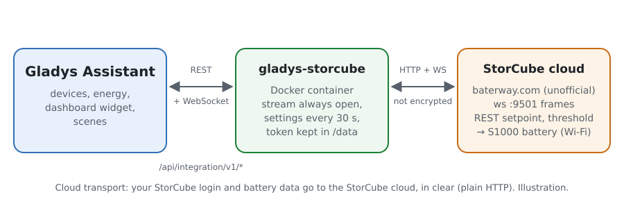
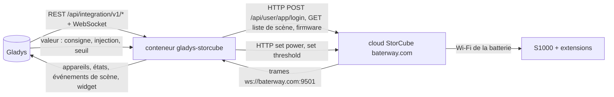
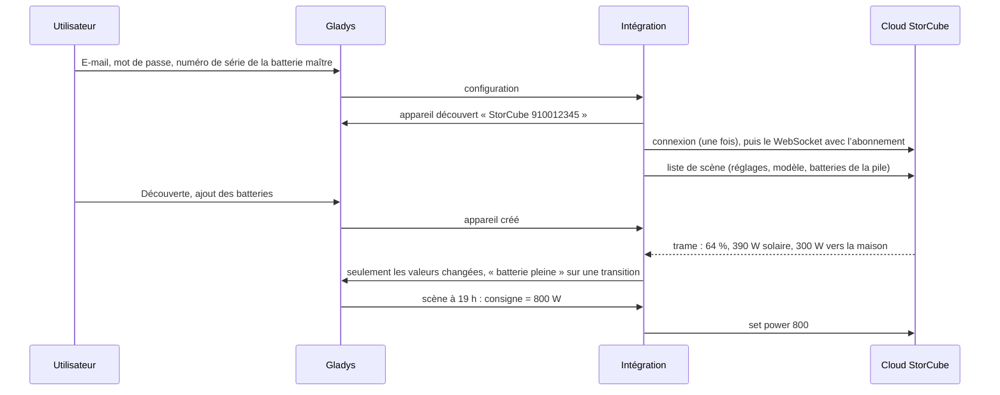
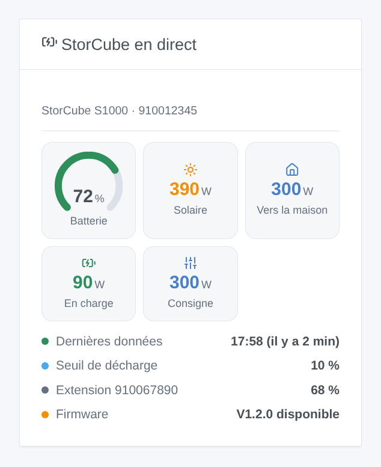

# Gladys StorCube

[English](README.md) · **Français** · [Deutsch](README.de.md) · [Español](README.es.md)

[](LICENSE)
[](https://github.com/William-De71/gladys-storcube/releases)
[](https://github.com/William-De71/gladys-storcube/actions/workflows/release.yml)
[](https://gladysassistant.com)



Intégration externe de [Gladys Assistant](https://gladysassistant.com) pour les batteries de balcon **StorCube** (S1000 et ses batteries d’extension), par le cloud StorCube et le compte de l’application StorCube. Elle affiche dans Gladys le niveau de la batterie, la puissance solaire et la puissance injectée dans la maison, et permet à vos scènes d’activer ou de couper l’injection, de changer la consigne de sortie et le seuil de décharge — par exemple pour restituer l’énergie le soir.

Documentation utilisateur : [English](docs/en.md) · [Français](docs/fr.md) · [Deutsch](docs/de.md) · [Español](docs/es.md).

Non affiliée à StorCube. **L’API du cloud StorCube n’est ni documentée ni officielle** : les requêtes et les trames suivent l’intégration Home Assistant [storcube_Ha](https://github.com/jon7119/storcube_Ha) (MIT), qui lit de vraies batteries S1000. **Pas encore testée avec une vraie batterie** ; seule la réponse à un compte inconnu a été vérifiée pour de vrai. Les retours sont bienvenus sur le [fil du forum](https://community.gladysassistant.com/t/demande-integration-batterie-storcube-s1000/11472).

## Fonctionnalités

- **Un appareil par batterie** de la pile : niveau, énergie stockée, température.
- Sur la **batterie maître** (celle reliée aux panneaux et au micro-onduleur) : puissance solaire (PV1 + PV2), puissance injectée dans la maison, puissances de charge et de décharge, et trois commandes — **consigne de sortie** (0 à 800 W), **injection activée / coupée** (coupée = 0 W, activée = la dernière consigne), **seuil de décharge** (0 à 100 %).
- **Temps réel** : le flux WebSocket du cloud StorCube, plus les réglages de la pile toutes les 30 secondes.
- **6 déclencheurs de scène** (batterie pleine, batterie au seuil, batterie muette, batterie de retour, mise à jour firmware, connexion refusée) et **1 widget de tableau de bord** (la pile en direct).
- **Une seule connexion**, son jeton gardé 12 heures (le cloud supporte mal plusieurs sessions d’un même compte) ; une connexion refusée arrête tout jusqu’à ce que vous changiez la configuration, pour ne jamais bloquer le compte.
- Quatre langues partout : anglais, français, allemand, espagnol.

## Fonctionnement





Du compte à une scène :



### Transport

`transports: ["cloud"]` : tout passe par le cloud StorCube (`baterway.com`), le serveur qu’utilise l’application StorCube. **Votre e-mail, votre mot de passe et les données de vos batteries quittent votre réseau, sans chiffrement** (HTTP et WebSocket simples, exactement comme l’application) : utilisez un mot de passe que vous n’utilisez nulle part ailleurs. `/data` garde le jeton du cloud, les dernières lectures, les réglages de la pile et ce que savent les déclencheurs — jamais le mot de passe.

## Appareils et fonctionnalités

| Appareil                    | Fonctionnalités (catégorie / type)                                                                                                                                                                                                                                                                                                                                                                                                                                                                                                                                                                                       |
| --------------------------- | ------------------------------------------------------------------------------------------------------------------------------------------------------------------------------------------------------------------------------------------------------------------------------------------------------------------------------------------------------------------------------------------------------------------------------------------------------------------------------------------------------------------------------------------------------------------------------------------------------------------------ |
| Batterie maître             | Niveau de batterie (`battery-storage` / `battery-level`, %), énergie stockée (`battery-storage` / `battery-energy-remaining`, kWh), puissances de charge et de décharge (`battery-storage` / `charge-power`, `discharge-power`, W), puissance solaire (`energy-production-sensor` / `power`, W), puissance injectée dans la maison (`home-output-sensor` / `power`, W), consigne de sortie (`switch` / `dimmer`, 0–800 W, modifiable), injection vers la maison (`switch` / `binary`, modifiable), seuil de décharge (`switch` / `dimmer`, 0–100, modifiable), température (`device-temperature-sensor` / `decimal`, °C) |
| Chaque batterie d’extension | Niveau de batterie, énergie stockée, température                                                                                                                                                                                                                                                                                                                                                                                                                                                                                                                                                                         |

- **Puissance de la batterie** : l’API n’en donne pas ; comme storcube_Ha, l’intégration la calcule (solaire moins puissance injectée), séparée en puissance de charge et de décharge (toutes deux positives), comme le veut la catégorie batterie de stockage de Gladys.
- **Consigne et seuil** sont des fonctionnalités `switch` / `dimmer` : aucun type de Gladys n’est une consigne de puissance, et le variateur est le niveau modifiable que le tableau de bord affiche en curseur et que les scènes savent régler. Le seuil n’a pas d’unité (`%` n’est pas une unité de la catégorie interrupteur) ; son nom l’indique.
- **Pas d’index d’énergie** : les trames arrivent irrégulièrement, parfois à plusieurs minutes d’écart ; un index intégré à partir d’elles serait approximatif. Gladys garde l’historique des puissances.
- Les identifiants externes reposent sur les numéros de série : `ext:storcube:battery:<numéro>`.

## Déclencheurs de scène et widgets



**Widget** StorCube en direct : jauge de batterie (rouge au seuil), solaire, puissance vers la maison, charge ou décharge, consigne (ou « injection coupée »), l’heure des dernières données (ou « muette depuis »), le seuil de décharge, le niveau de chaque batterie d’extension et un firmware en attente.

**Déclencheurs** (un événement par transition, jamais à la première lecture, jamais en conséquence d’une commande) :

- **batterie pleine** à 100 % (à nouveau après être repassée sous 95 %) ;
- **batterie au seuil** : le niveau atteint le seuil de décharge, la batterie n’injecte plus (à nouveau 5 points au-dessus) ;
- **batterie muette** : aucune trame depuis 20 minutes alors que le cloud répond ; **batterie de retour** quand les trames reviennent ;
- **mise à jour firmware** : le cloud propose un nouveau firmware (une fois par version) ;
- **connexion refusée** : le cloud refuse l’e-mail ou le mot de passe (une fois).

Filtre : la batterie. Les valeurs (niveau, puissances) sont des fonctionnalités d’appareil : « batterie au-dessus de 80 % » est un déclencheur d’appareil de Gladys.

Pas d’action de scène : les commandes sont des fonctionnalités d’appareil, réglées par l’action **Contrôler un appareil** des scènes.

Exemples :

- Chaque jour à 19 h → régler **Consigne de sortie** sur 800 W ; à 23 h → couper **Injection vers la maison** : la batterie restitue son énergie le soir.
- Quand **StorCube : batterie pleine** → régler la consigne sur 300 W pour que la maison consomme directement le soleil.
- Quand **StorCube : batterie muette** → envoyer une notification « {{triggerEvent.data.battery_name}} n’envoie plus rien au cloud StorCube ».

## Prérequis

- Gladys Assistant **5.3.0** ou plus récent (mots-clés du catalogue, widgets et scènes des intégrations) : les instances plus anciennes ne peuvent pas installer l’intégration.
- Une batterie StorCube configurée dans l’application StorCube, son e-mail et son mot de passe, et le numéro de série de la batterie maître (sur son étiquette ou dans l’application).
- Internet : l’intégration ne parle qu’à `baterway.com`.

### Limites du cloud StorCube

- API non officielle : StorCube peut la changer à tout moment et casser l’intégration.
- HTTP simple : le mot de passe circule en clair, comme avec l’application.
- Un compte, plusieurs sessions : l’application et Gladys peuvent se gêner ; l’intégration se connecte une fois et garde son jeton.
- Les trames mettent parfois plusieurs minutes ; les batteries d’extension ne donnent que niveau, énergie et température.
- Le nom du champ du seuil change selon le firmware : l’intégration essaie `reserved`, `threshold`, `data` et garde celui qui est accepté.

## Installation

- **Depuis le store** : Intégrations → StorCube → Installer.
- **Depuis l’URL du dépôt** : Intégrations → intégration externe → `https://github.com/William-De71/gladys-storcube`.
- **Mode développeur** : lancez `npm start` avec les variables données par Gladys (voir Développement).

## Configuration

| Champ ou bouton                       | Défaut      | Rôle                                                                                 |
| ------------------------------------- | ----------- | ------------------------------------------------------------------------------------ |
| E-mail de l’application StorCube      | —           | Obligatoire                                                                          |
| Mot de passe                          | —           | Obligatoire, secret : jamais réaffiché, jamais journalisé, jamais écrit dans `/data` |
| Numéro de série de la batterie maître | —           | Obligatoire : la batterie reliée aux panneaux et au micro-onduleur                   |
| Code application                      | Storcube    | À laisser, sauf si votre batterie utilise une autre application du même cloud        |
| Langue des textes                     | automatique | Noms des fonctionnalités et erreurs                                                  |
| Tester la connexion / Diagnostic      | —           | Se connecte et lit les réglages ; l’état dans les journaux, sans le mot de passe     |

## Utilisation

1. Dans Gladys (Intégrations → StorCube → Configuration) : renseignez l’e-mail, le mot de passe et le numéro de série ; appuyez sur **Tester la connexion**.
2. **Découverte**, puis ajoutez vos batteries comme appareils.
3. Ajoutez le widget à un tableau de bord ; créez des scènes avec les fonctionnalités et les déclencheurs (par exemple l’injection du soir ci-dessus).

## Développement

```bash
npm install
npm test                       # node --test, un faux cloud StorCube sur 127.0.0.1, jamais le réseau
npm run lint                   # ESLint
npm run format:check           # Prettier
npx github:GladysAssistant/integration-store . --skip-image-check
scripts/build-cover.sh         # cover.jpg depuis docs/assets/cover.svg (logo intégré)
docs/illustrations/render.sh   # docs/assets/widgets.<langue>.png
```

En local, le SDK lit `GLADYS_HOST_API_URL`, `GLADYS_INTEGRATION_TOKEN` et `GLADYS_INTEGRATION_SELECTOR` (donnés par Gladys en mode développeur), et l’intégration lit `TZ`. `DEBUG=gladys-integration-sdk` affiche les journaux du SDK.

Les tests couvrent le client REST (connexion, connexion refusée, jeton expiré, repli du champ de seuil), le flux WebSocket (jeton dans le chemin et l’en-tête, abonnement, silence, reconnexion), l’analyse (les trois formes de trames, les totaux à la batterie maître seulement), les déclencheurs, les appareils (les champs qu’exige l’écran de découverte, les contrats de catégorie du cœur), le widget (`validateWidgetContent`), le manifeste, les quatre langues, le script de release, et toute l’intégration face au faux Gladys du SDK et à un faux cloud StorCube. `test/structure.test.js` fige chaque clé que les utilisateurs stockent.

## Processus de release


Chaque fusion sur `main` lance la CI, puis calcule la version à partir des [Conventional Commits](https://www.conventionalcommits.org/) depuis le dernier tag : `feat` → mineure, `fix` / `perf` → correctif, `!` ou `BREAKING CHANGE` → majeure (une mineure sous 1.0.0) ; `docs`, `chore`, `ci`, `test`, `style`, `refactor`, `build` seuls ne publient rien. La section du changelog est générée, le tag poussé, l’image multi-architecture construite, puis `main` reçoit le commit de release, la GitHub Release est créée et un dernier job vérifie l’image publique, le validateur du store et le topic.

- Le titre de la pull request devient le commit squash, puis la ligne du changelog : écrivez-le en anglais, pour l’utilisateur (`pr-title.yml` le vérifie). Ne modifiez jamais `CHANGELOG.md` à la main.
- 1.0.0 est une décision : Actions → Release → Run workflow avec `release-as: 1.0.0`. `dry-run` affiche la version et les notes sans rien publier.
- **Branche protégée** : la release pousse son commit sur `main` avec `GITHUB_TOKEN`. Le ruleset `protect-main` (ni suppression, ni force-push) le laisse passer ; une règle plus stricte (pull request obligatoire, status checks) demanderait d’ajouter GitHub Actions aux exceptions, ou une GitHub App.
- Après la première release, rendez public le package `ghcr.io` (Package settings → Change visibility), sinon Gladys ne peut pas le télécharger.

## Dépannage

Voir [docs/fr.md](docs/fr.md#dépannage). Signalez les problèmes avec les versions de Gladys et de l’intégration, le modèle et le firmware de la batterie, le message de **Tester la connexion** et le résultat de **Diagnostic** (dans les journaux de l’intégration). Ne collez jamais votre mot de passe.

## Contribuer

Les issues et pull requests sont bienvenues, surtout de la part de propriétaires de StorCube : de vraies trames (sans le numéro de série) aident beaucoup. Lancez `npm run format:check && npm run lint && npm test` avant d’ouvrir une pull request, et gardez inchangés tous les identifiants externes et clés stockées (voir [CLAUDE.md](CLAUDE.md)).

## Sécurité

Voir [SECURITY.md](SECURITY.md) : signalez les failles en privé. Le mot de passe est un champ `secret` : jamais journalisé, jamais écrit dans `/data` ; il circule en revanche en clair vers le cloud StorCube, qui ne propose rien d’autre.

## Captures d’écran à venir

Les images ci-dessus sont des illustrations, pas des captures d’écran. Les vraies captures iront dans `docs/assets/screenshots/` (PNG, 1280 × 800) : `configuration.png`, `discovery.png`, `device.png` (la batterie maître et ses fonctionnalités), `scene-evening-injection.png` (la scène qui règle la consigne à 19 h).

## Licence

[Licence Apache 2.0](LICENSE) — voir aussi [NOTICE](NOTICE). StorCube et son logo sont des marques de leur propriétaire ; ce projet n’est ni affilié, ni approuvé, ni sponsorisé par StorCube. Merci à la documentation et au SDK de Gladys, et à jon7119 et xez7082 pour storcube_Ha, qui documente le cloud StorCube.
