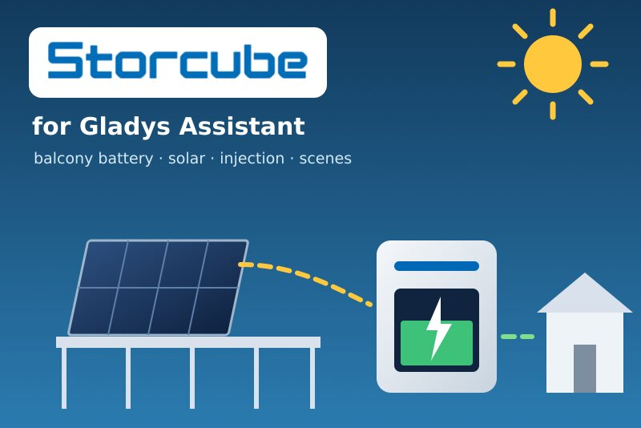
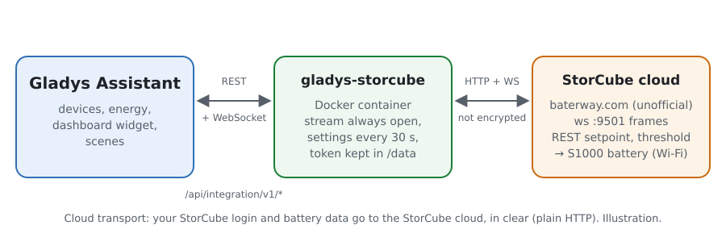
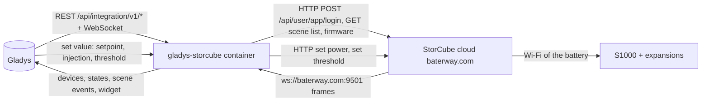
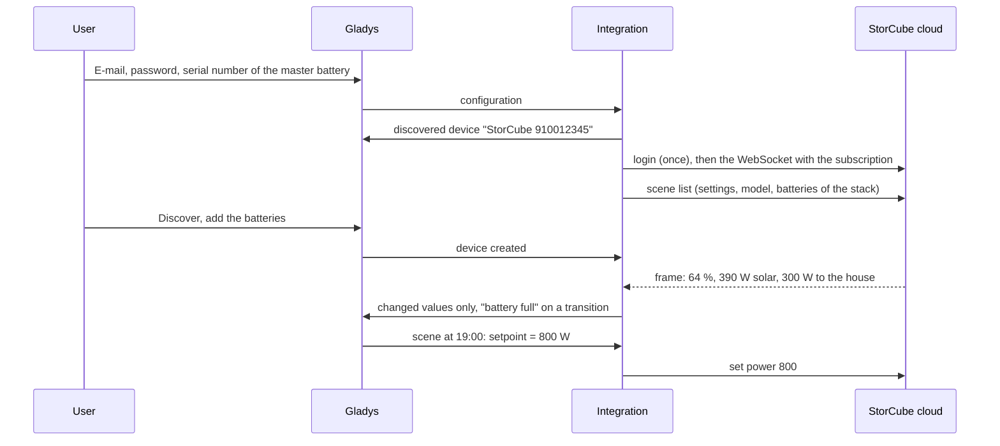
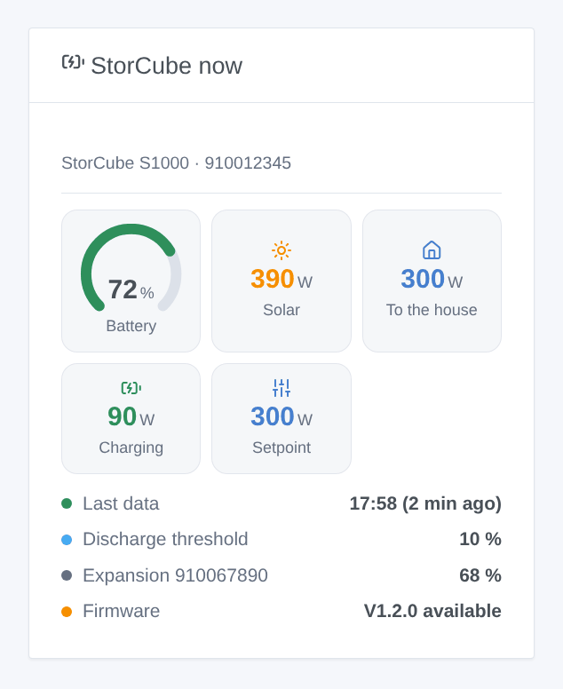

# Gladys StorCube

**English** · [Français](README.fr.md) · [Deutsch](README.de.md) · [Español](README.es.md)

[](LICENSE)
[](https://github.com/William-De71/gladys-storcube/releases)
[](https://github.com/William-De71/gladys-storcube/actions/workflows/release.yml)
[](https://gladysassistant.com)



[Gladys Assistant](https://gladysassistant.com) external integration for **StorCube** balcony batteries (S1000 and its expansion batteries), through the StorCube cloud and the account of the StorCube app. It shows the battery level, the solar power and the power sent to your house in Gladys, and lets your scenes switch the injection on or off, change the output setpoint and the discharge threshold — for instance to give the energy back in the evening.

User documentation: [English](docs/en.md) · [Français](docs/fr.md) · [Deutsch](docs/de.md) · [Español](docs/es.md).

Not affiliated with StorCube. **The StorCube cloud API is neither documented nor official**: the requests and frames follow the Home Assistant integration [storcube_Ha](https://github.com/jon7119/storcube_Ha) (MIT), which reads real S1000 batteries. **Not tested with a real battery yet**; only the answer to an unknown account was checked for real. Feedback welcome on the [forum thread](https://community.gladysassistant.com/t/demande-integration-batterie-storcube-s1000/11472).

## Features

- **One device per battery** of the stack: level, stored energy, temperature.
- On the **master battery** (the one wired to the panels and the micro-inverter): solar power (PV1 + PV2), power sent to the house, battery charge and discharge power, and three commands — **output setpoint** (0 to 800 W), **injection on / off** (off = 0 W, on = the last setpoint), **discharge threshold** (0 to 100 %).
- **Real time**: the WebSocket stream of the StorCube cloud, plus the settings of the stack every 30 seconds.
- **6 scene triggers** (battery full, battery at its threshold, battery silent, battery back, firmware update, login refused) and **1 dashboard widget** (the stack now).
- **One login**, its token kept 12 hours (the cloud tolerates several sessions of one account badly); a refused login stops everything until you change the configuration, so the account is never locked out.
- Four languages everywhere: English, French, German, Spanish.

## How it works





From the account to a scene:



### Transport

`transports: ["cloud"]`: everything goes through the StorCube cloud (`baterway.com`), the server the StorCube app uses. **Your e-mail, your password and the data of your batteries leave your network, unencrypted** (plain HTTP and WebSocket, exactly like the app): use a password you use nowhere else. `/data` keeps the token of the cloud, the last readings, the settings of the stack and what the triggers know — never the password.

## Devices and features

| Device                 | Features (category / type)                                                                                                                                                                                                                                                                                                                                                                                                                                                                                                                                                      |
| ---------------------- | ------------------------------------------------------------------------------------------------------------------------------------------------------------------------------------------------------------------------------------------------------------------------------------------------------------------------------------------------------------------------------------------------------------------------------------------------------------------------------------------------------------------------------------------------------------------------------- |
| Master battery         | Battery level (`battery-storage` / `battery-level`, %), energy stored (`battery-storage` / `battery-energy-remaining`, kWh), charge and discharge power (`battery-storage` / `charge-power`, `discharge-power`, W), solar power (`energy-production-sensor` / `power`, W), power sent to the house (`home-output-sensor` / `power`, W), output setpoint (`switch` / `dimmer`, 0–800 W, writable), injection to the house (`switch` / `binary`, writable), discharge threshold (`switch` / `dimmer`, 0–100, writable), temperature (`device-temperature-sensor` / `decimal`, °C) |
| Each expansion battery | Battery level, energy stored, temperature                                                                                                                                                                                                                                                                                                                                                                                                                                                                                                                                       |

- **Battery power**: the API gives none; like storcube_Ha, the integration works it out as solar minus the power sent to the house, split into charge and discharge power (both positive), as the battery-storage category of Gladys wants.
- **Setpoint and threshold** are `switch` / `dimmer` features: no Gladys type is a power setpoint, and the dimmer is the writable level the dashboard shows as a slider and the scenes can set. The threshold has no unit (`%` is not a unit of the switch category); its name says it.
- **No energy index**: the frames come irregularly, sometimes minutes apart; an index integrated from them would be a guess. Gladys keeps the history of the powers.
- External ids rest on the serial numbers: `ext:storcube:battery:<serial>`.

## Scene triggers and widgets



**Widget** StorCube now: battery gauge (red at the threshold), solar, power to the house, charging or discharging, setpoint (or "injection off"), the time of the last data (or "silent since"), the discharge threshold, the level of each expansion battery and a firmware waiting.

**Triggers** (one event per transition, never at the first reading, never as the result of a command):

- **battery full** at 100 % (again after going under 95 %);
- **battery at its threshold**: the level reaches the discharge threshold, the battery stops sending power (again 5 points above);
- **battery silent**: no frame for 20 minutes while the cloud answers; **battery back** when frames come again;
- **firmware update**: the cloud offers a new firmware (once per version);
- **login refused**: the cloud refuses the e-mail or the password (once).

Filter: the battery. The values (level, powers) are device features: "battery above 80 %" is a device trigger of Gladys.

No scene action: the commands are device features, set by the **Control a device** action of the scenes.

Examples:

- Every day at 19:00 → set **Output setpoint** to 800 W; at 23:00 → set **Injection to the house** off: the battery gives its energy back in the evening.
- When **StorCube: battery full** → set the setpoint to 300 W so the house uses the sun directly.
- When **StorCube: battery silent** → send a notification "{{triggerEvent.data.battery_name}} sends nothing to the StorCube cloud".

## Requirements

- Gladys Assistant **5.3.0** or later (catalog keywords, widgets and scenes of integrations): older instances cannot install the integration.
- A StorCube battery set up in the StorCube app, its e-mail and password, and the serial number of the master battery (on its label or in the app).
- The internet: the integration talks to `baterway.com` only.

### Limits of the StorCube cloud

- Unofficial API: StorCube can change it at any time and break the integration.
- Plain HTTP: the password travels in clear, as with the app.
- One account, several sessions: the app and Gladys may disturb each other; the integration logs in once and keeps its token.
- Frames sometimes take minutes; the expansion batteries only report level, energy and temperature.
- The threshold field name changes with the firmware: the integration tries `reserved`, `threshold`, `data` and keeps the one accepted.

## Installation

- **From the store**: Integrations → StorCube → Install.
- **From the repository URL**: Integrations → external integration → `https://github.com/William-De71/gladys-storcube`.
- **Developer mode**: run `npm start` with the variables given by Gladys (see Development).

## Configuration

| Field or button                     | Default   | Meaning                                                                       |
| ----------------------------------- | --------- | ----------------------------------------------------------------------------- |
| E-mail of the StorCube app          | —         | Required                                                                      |
| Password                            | —         | Required, a secret: never shown again, never logged, never written to `/data` |
| Serial number of the master battery | —         | Required: the battery wired to the panels and the micro-inverter              |
| App code                            | Storcube  | Leave it, unless your battery uses another app of the same cloud              |
| Language of the texts               | automatic | Feature names and errors                                                      |
| Test the connection / Diagnostic    | —         | Logs in and reads the settings; the state in the logs, without the password   |

## Usage

1. In Gladys (Integrations → StorCube → Configuration): fill in the e-mail, the password and the serial number; press **Test the connection**.
2. **Discover**, then add your batteries as devices.
3. Add the widget to a dashboard; build scenes with the features and the triggers (for instance the evening injection above).

## Development

```bash
npm install
npm test                       # node --test, a fake StorCube cloud on 127.0.0.1, never the network
npm run lint                   # ESLint
npm run format:check           # Prettier
npx github:GladysAssistant/integration-store . --skip-image-check
scripts/build-cover.sh         # cover.jpg from docs/assets/cover.svg (logo inlined)
docs/illustrations/render.sh   # docs/assets/widgets.<lang>.png
```

Locally, the SDK reads `GLADYS_HOST_API_URL`, `GLADYS_INTEGRATION_TOKEN` and `GLADYS_INTEGRATION_SELECTOR` (given by Gladys in developer mode), and the integration reads `TZ`. `DEBUG=gladys-integration-sdk` shows the SDK logs.

The tests cover the REST client (login, refused login, expired token, threshold field fallback), the WebSocket stream (token in the path and the header, subscription, silence, reconnection), the parser (the three frame shapes, totals to the master only), the triggers, the devices (the fields the Discovery screen requires, the core category contracts), the widget (`validateWidgetContent`), the manifest, the four languages, the release script, and the whole integration against the fake Gladys of the SDK and a fake StorCube cloud. `test/structure.test.js` freezes every key users store.

## Release process


Every merge on `main` runs the CI, then computes the version from the [Conventional Commits](https://www.conventionalcommits.org/) since the last tag: `feat` → minor, `fix` / `perf` → patch, `!` or `BREAKING CHANGE` → major (a minor below 1.0.0); `docs`, `chore`, `ci`, `test`, `style`, `refactor`, `build` alone publish nothing. The changelog section is generated, the tag pushed, the multi-architecture image built, then `main` receives the release commit, the GitHub Release is created and a last job checks the public image, the store validator and the topic.

- The pull request title becomes the squash commit, then the changelog line: write it in English, for the user (`pr-title.yml` checks it). Never edit `CHANGELOG.md` by hand.
- 1.0.0 is a decision: Actions → Release → Run workflow with `release-as: 1.0.0`. `dry-run` shows the version and the notes without publishing.
- **Protected branch**: the release pushes its commit to `main` with `GITHUB_TOKEN`. The `protect-main` ruleset (no deletion, no force-push) lets it through; a stricter rule (pull request required, status checks) would need GitHub Actions in its bypass list, or a GitHub App.
- After the first release, make the `ghcr.io` package public (Package settings → Change visibility), or Gladys cannot pull it.

## Troubleshooting

See [docs/en.md](docs/en.md#troubleshooting). Report issues with the versions of Gladys and of the integration, the model and firmware of the battery, the message of **Test the connection** and the result of **Diagnostic** (in the logs of the integration). Never paste your password.

## Contributing

Issues and pull requests are welcome, especially from StorCube owners: real frames (without the serial number) help a lot. Run `npm run format:check && npm run lint && npm test` before opening a pull request, and keep every external id and stored key unchanged (see [CLAUDE.md](CLAUDE.md)).

## Security

See [SECURITY.md](SECURITY.md): report vulnerabilities privately. The password is a `secret` field: never logged, never written to `/data`; it does travel in clear to the StorCube cloud, which offers nothing else.

## Screenshots to come

The images above are illustrations, not screenshots. Real screenshots will go in `docs/assets/screenshots/` (PNG, 1280 × 800): `configuration.png`, `discovery.png`, `device.png` (the master battery with its features), `scene-evening-injection.png` (the scene that sets the setpoint at 19:00).

## License

[Apache License 2.0](LICENSE) — see also [NOTICE](NOTICE). StorCube and its logo are trademarks of their owner; this project is not affiliated with, endorsed or sponsored by StorCube. Thanks to the Gladys documentation and SDK, and to jon7119 and xez7082 for storcube_Ha, which documents the StorCube cloud.
