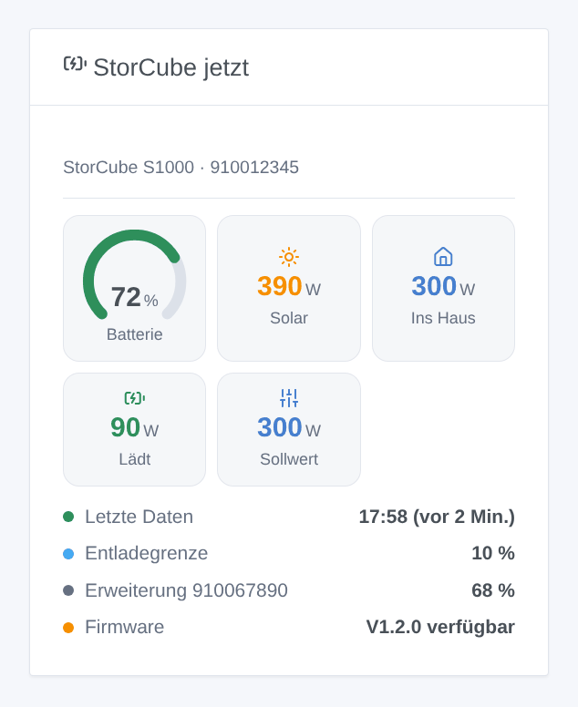

# StorCube

## Überblick

Diese Integration bringt eine **StorCube-Balkonbatterie** (S1000 und ihre Erweiterungsbatterien) über die StorCube-Cloud und das Konto der StorCube-App in Gladys. Du siehst den Batteriestand, die Solarleistung und die ins Haus eingespeiste Leistung, und deine Szenen können die Einspeisung ein- oder ausschalten, den Ausgangssollwert (0 bis 800 W) und die Entladegrenze ändern — zum Beispiel, um die Energie am Abend abzugeben.

Gut zu wissen vor der Installation:

- Die API der StorCube-Cloud ist **weder dokumentiert noch offiziell**. Die Integration folgt der Home-Assistant-Integration storcube_Ha, die echte Batterien liest; StorCube kann seine API jederzeit ändern.
- Alles läuft über die Cloud (`baterway.com`), **unverschlüsselt**: E-Mail und Passwort gehen im Klartext, wie bei der StorCube-App selbst. Nutze ein Passwort, das du nirgends sonst verwendest.
- Die Integration wurde **noch nicht mit einer echten Batterie getestet**. Rückmeldungen sind willkommen.
- Nicht mit StorCube verbunden.

## Voraussetzungen

- Gladys Assistant 5.3.0 oder neuer.
- Eine in der StorCube-App eingerichtete StorCube-Batterie mit WLAN-Verbindung.
- E-Mail und Passwort des Kontos der StorCube-App.
- Die Seriennummer der **Hauptbatterie**: die Batterie, an der Solarmodule und Mikro-Wechselrichter hängen. Sie steht auf dem Etikett der Batterie und in der App.

## Konfiguration

In Gladys: **Integrationen → StorCube → Konfiguration**.

| Feld                           | Eingabe                                                                              |
| ------------------------------ | ------------------------------------------------------------------------------------ |
| E-Mail der StorCube-App        | Die E-Mail, mit der du dich in der App anmeldest                                     |
| Passwort                       | Ihr Passwort (als Geheimnis gespeichert, nie wieder angezeigt)                       |
| Seriennummer der Hauptbatterie | Die Ziffern auf dem Etikett; Leerzeichen und Bindestriche werden entfernt            |
| App-Code                       | `Storcube` stehen lassen, außer deine Batterie nutzt eine andere App derselben Cloud |
| Sprache der Texte              | Automatisch folgt der Sprache des Dashboards                                         |

Speichern, dann **Verbindung testen** drücken: Sie meldet sich an und zeigt Modell, Anzahl der Batterien im Stapel, Sollwert und Grenze.

Lehnt die Cloud E-Mail oder Passwort ab, versucht es die Integration nicht mehr, bis du die Konfiguration änderst — so wird dein Konto nie gesperrt.

## Nutzung

### Geräte

Öffne **Suchen** und füge die Batterien hinzu. Die Hauptbatterie bietet:

- Batteriestand (%), gespeicherte Energie (kWh), Temperatur (°C);
- Solarleistung (W, beide Eingänge zusammen), ins Haus eingespeiste Leistung (W);
- Lade- und Entladeleistung (W): berechnet als Solar minus eingespeiste Leistung, da die API keine Batterieleistung liefert;
- **Ausgangssollwert (W)**: ein Schieberegler von 0 bis 800 W, die Leistung, die die Batterie ins Haus schickt;
- **Einspeisung ins Haus**: aus setzt den Sollwert auf 0 W, ein stellt den letzten Sollwert über 0 wieder her (800 W, wenn keiner bekannt ist);
- **Entladegrenze (%)**: der Stand, unter dem die Batterie nicht mehr einspeist.

Jede Erweiterungsbatterie bietet Stand, gespeicherte Energie und Temperatur. Die Werte kommen aus dem Echtzeit-Datenstrom der StorCube-Cloud; die Einstellungen werden alle 30 Sekunden neu gelesen.

### Dashboard-Widgets

**StorCube jetzt** zeigt die Batterieanzeige, die Solarleistung, die Leistung ins Haus, Laden oder Entladen, den Sollwert (oder „Einspeisung aus“), wann die letzten Daten kamen, die Entladegrenze, jede Erweiterungsbatterie und ein wartendes Firmware-Update.

### Szenen

Auslöser (einmal pro Änderung, nie beim ersten Messwert):

- **StorCube: Batterie voll** — 100 %, erneut nachdem sie unter 95 % fiel;
- **StorCube: Batterie an der Grenze** — die Batterie speist nicht mehr ein;
- **StorCube: Batterie stumm** — seit 20 Minuten keine Daten, obwohl die Cloud antwortet; **Batterie zurück**, wenn wieder Daten kommen;
- **StorCube: Firmware-Update** — eine neue Firmware wird angeboten (einmal pro Version);
- **StorCube: Anmeldung abgelehnt** — die Cloud lehnt E-Mail oder Passwort ab.

Die Befehle sind Gerätefunktionen: Nutze die Aktion **Ein Gerät steuern**. Beispiele:

- **Abendliche Einspeisung**: jeden Tag um 19 Uhr → Ausgangssollwert = 800 W; um 23 Uhr → Einspeisung ins Haus = aus.
- **Erst die Sonne**: wenn die Batterie voll ist → Ausgangssollwert = 300 W.
- **Batterie überwachen**: wenn die Batterie stumm ist → eine Benachrichtigung senden.

## Fehlerbehebung

- **„Die StorCube-Cloud lehnt die Anmeldung ab“**: Prüfe E-Mail und Passwort in der StorCube-App und speichere die Konfiguration erneut (das erlaubt einen neuen Versuch).
- **„kennt die Batterie nicht“**: Die Seriennummer ist nicht die der Hauptbatterie dieses Kontos. Nimm die der Batterie, an der die Module hängen.
- **Keine Daten, „warte auf die Daten“**: Die StorCube-Cloud braucht manchmal mehrere Minuten für den ersten Datenrahmen. Prüfe in der App, ob die Batterie online ist.
- **Die App meldet dich ab, oder Gladys empfängt nichts mehr**: Die Cloud verträgt mehrere Sitzungen eines Kontos schlecht. Vermeide andere Werkzeuge mit demselben Konto.
- **Ein Befehl wird abgelehnt**: Nur die Hauptbatterie nimmt Befehle an; der Feldname der Grenze unterscheidet sich je nach Firmware, und die Integration probiert die bekannten.
- Für eine Fehlermeldung **Diagnose** drücken und die Zeilen „StorCube diagnostic“ aus dem Protokoll der Integration kopieren (ohne Passwort), mit den Versionen von Gladys und der Integration sowie Modell und Firmware der Batterie.
