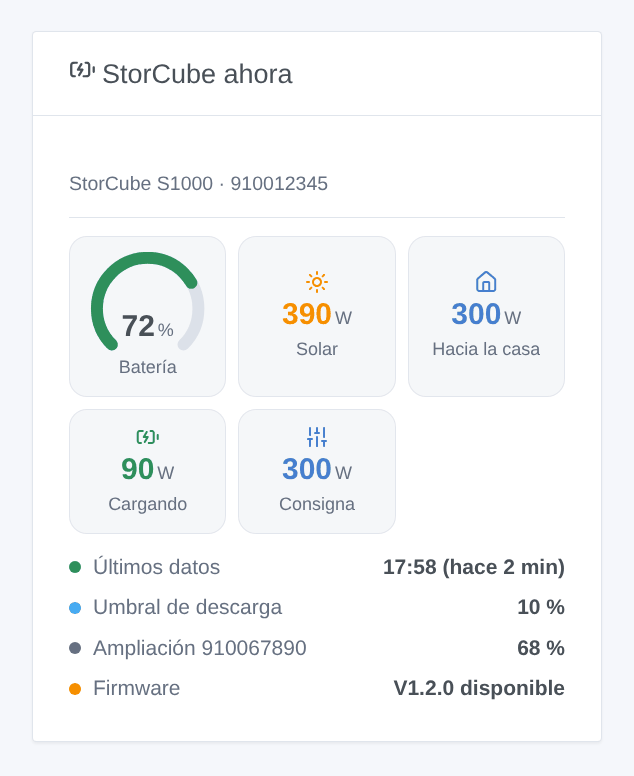

# StorCube

## Presentación

Esta integración trae una **batería de balcón StorCube** (S1000 y sus baterías de ampliación) a Gladys, a través de la nube de StorCube y la cuenta de la aplicación StorCube. Verá el nivel de la batería, la potencia solar y la potencia inyectada en la casa, y sus escenas podrán activar o cortar la inyección, cambiar la consigna de salida (0 a 800 W) y el umbral de descarga — por ejemplo, para devolver la energía por la noche.

Conviene saber antes de instalar:

- La API de la nube de StorCube **no está documentada ni es oficial**. La integración sigue la integración de Home Assistant storcube_Ha, que lee baterías reales; StorCube puede cambiar su API en cualquier momento.
- Todo pasa por la nube (`baterway.com`), **sin cifrar**: su correo y su contraseña viajan en claro, como con la propia aplicación StorCube. Use una contraseña que no utilice en ningún otro sitio.
- La integración **aún no se ha probado con una batería real**. Sus comentarios son bienvenidos.
- No afiliada a StorCube.

## Requisitos

- Gladys Assistant 5.3.0 o posterior.
- Una batería StorCube configurada en la aplicación StorCube, conectada al Wi-Fi.
- El correo y la contraseña de la cuenta de la aplicación StorCube.
- El número de serie de la **batería principal**: la conectada a los paneles solares y al microinversor. Figura en la etiqueta de la batería y en la aplicación.

## Configuración

En Gladys: **Integraciones → StorCube → Configuración**.

| Campo                                   | Qué indicar                                                                |
| --------------------------------------- | -------------------------------------------------------------------------- |
| Correo de la aplicación StorCube        | El correo con el que inicia sesión en la aplicación                        |
| Contraseña                              | Su contraseña (guardada como secreto, nunca se vuelve a mostrar)           |
| Número de serie de la batería principal | Las cifras de la etiqueta; se quitan los espacios y guiones                |
| Código de aplicación                    | Deje `Storcube`, salvo que su batería use otra aplicación de la misma nube |
| Idioma de los textos                    | Automático sigue el idioma del panel                                       |

Guarde y pulse **Probar la conexión**: inicia sesión y muestra el modelo, el número de baterías de la pila, la consigna y el umbral.

Si la nube rechaza el correo o la contraseña, la integración deja de intentarlo hasta que cambie la configuración, para no bloquear nunca su cuenta.

## Uso

### Dispositivos

Abra **Descubrir** y añada las baterías. La batería principal ofrece:

- nivel de batería (%), energía almacenada (kWh), temperatura (°C);
- potencia solar (W, las dos entradas sumadas), potencia inyectada en la casa (W);
- potencia de carga y potencia de descarga (W): calculadas como solar menos potencia inyectada, ya que la API no da la potencia de la batería;
- **Consigna de salida (W)**: un control deslizante de 0 a 800 W, la potencia que la batería envía a la casa;
- **Inyección a la casa**: cortada pone la consigna a 0 W, activada recupera la última consigna por encima de 0 (800 W si no se conoce ninguna);
- **Umbral de descarga (%)**: el nivel por debajo del cual la batería deja de inyectar.

Cada batería de ampliación ofrece su nivel, energía almacenada y temperatura. Los valores llegan por el flujo en tiempo real de la nube de StorCube; los ajustes se vuelven a leer cada 30 segundos.

### Widgets del panel

**StorCube ahora** muestra el indicador de batería, la potencia solar, la potencia hacia la casa, la carga o descarga, la consigna (o «inyección cortada»), cuándo llegaron los últimos datos, el umbral de descarga, cada batería de ampliación y una actualización de firmware pendiente.

### Escenas

Disparadores (una vez por cambio, nunca en la primera lectura):

- **StorCube: batería llena** — 100 %, de nuevo tras bajar del 95 %;
- **StorCube: batería en el umbral** — la batería deja de inyectar;
- **StorCube: batería sin datos** — ningún dato en 20 minutos aunque la nube responde; **batería de vuelta** cuando vuelven los datos;
- **StorCube: actualización de firmware** — se ofrece un nuevo firmware (una vez por versión);
- **StorCube: inicio de sesión rechazado** — la nube rechaza el correo o la contraseña.

Las órdenes son funciones del dispositivo: use la acción **Controlar un dispositivo**. Ejemplos:

- **Inyección nocturna**: cada día a las 19:00 → Consigna de salida = 800 W; a las 23:00 → Inyección a la casa = cortada.
- **Primero el sol**: cuando la batería está llena → Consigna de salida = 300 W.
- **Vigilar la batería**: cuando la batería está sin datos → enviar una notificación.

## Solución de problemas

- **«La nube de StorCube rechaza el inicio de sesión»**: compruebe el correo y la contraseña en la aplicación StorCube y vuelva a guardar la configuración (eso permite un nuevo intento).
- **«no conoce la batería»**: el número de serie no es el de la batería principal de esta cuenta. Use el de la batería conectada a los paneles.
- **Sin datos, «esperando los datos»**: la nube de StorCube tarda a veces varios minutos en enviar la primera trama. Compruebe en la aplicación que la batería está en línea.
- **La aplicación le cierra la sesión, o Gladys deja de recibir datos**: la nube tolera mal varias sesiones de una misma cuenta. Evite otras herramientas con la misma cuenta.
- **Una orden es rechazada**: solo la batería principal acepta órdenes; el nombre del campo del umbral cambia según el firmware y la integración prueba los conocidos.
- Para informar de un error, pulse **Diagnóstico** y copie las líneas «StorCube diagnostic» de los registros de la integración (sin contraseña), con las versiones de Gladys y de la integración, y el modelo y el firmware de la batería.
